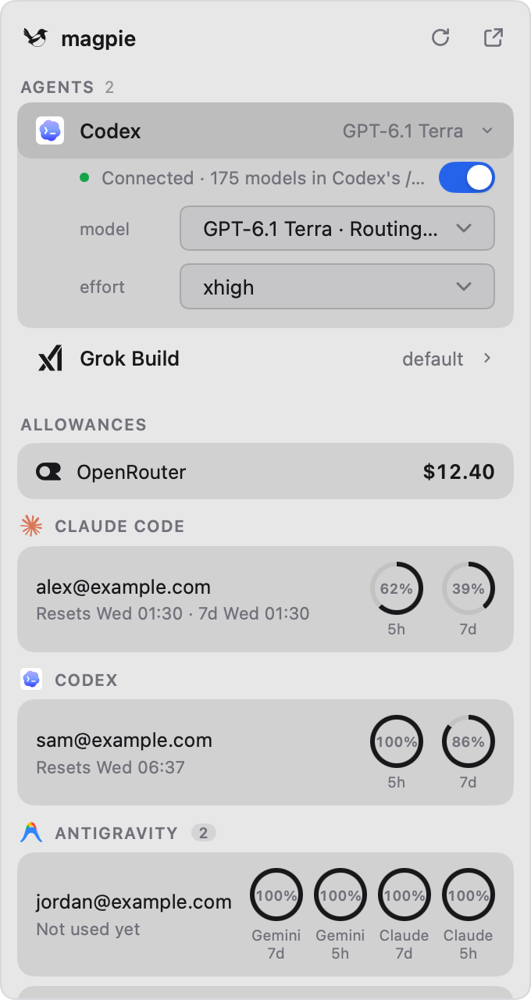

# Magpie for Metrix.Bar

[简体中文](README.zh-CN.md) · English

Control a [magpie](https://github.com/yetone/magpie) that runs somewhere else, such as on a server, from your menu bar. This [Metrix.Bar](https://metrix.bar/) dashboard talks to magpie's web API the same way magpie's own page does, so you can switch models and check allowances without opening a browser.

<p align="center">
  <picture>
    <source media="(prefers-color-scheme: dark)" srcset="screenshots/panel-en-dark.png">
    
  </picture>
</p>

## What it does

- **Agents**: one row per agent with its current model. Open a row to switch the model (grouped by where it comes from) and the reasoning effort, or to connect or disconnect the agent. The status line uses magpie's own wording.
- **Allowances**: grouped by provider, with a ring for each window and when it resets. Balances show beside the provider. Accounts that can't be read are folded into one line. Right-click a card to read it again.
- **Menu bar**: the first allowance's windows, such as `100% · 86%`. They read as used or left, as magpie is set to show them. If you picked allowances for magpie's own menu bar, those are shown instead.
- **Language and privacy**: follows magpie's language (English or Simplified Chinese) and its Hide accounts setting, which blurs email addresses and account names. Both can be set in the dashboard too.

## Install

You need [Metrix.Bar](https://metrix.bar/). Open this link to install Magpie from [this repository's registry](../README.md#install) and receive its updates:

```text
metrixbar://install/magpie?registry_url=https%3A%2F%2Fraw.githubusercontent.com%2Fthedavidweng%2Fmetrix-bar%2Fmain%2Findex.json
```

Or import the file directly. A direct import does not receive updates.

```text
metrixbar://install?url=https%3A%2F%2Fraw.githubusercontent.com%2Fthedavidweng%2Fmetrix-bar%2Fmain%2Fmagpie%2Fmagpie.bar&sha256=54696bec130e46afdade9f7bcecb6ba3d1a61dbc6c014890c1aadf356c0bbf82
```

## Set up

1. Open magpie's web page from the link it prints (magpie web, or Settings › Network and sharing › Browser access in the app). It looks like `http://HOST:PORT/?k=KEY`.
2. In the dashboard's settings, put `http://HOST:PORT` into **Magpie URL** and `KEY` into **Web Key**.

## Settings

| Setting            | Default        | What it does                                                           |
| ------------------ | -------------- | ---------------------------------------------------------------------- |
| Magpie URL         |                | magpie's web address: scheme, host and port, without the path or `?k=` |
| Web Key            |                | The value after `?k=`. Stored in the system keychain.                  |
| Language           | Same as magpie | English or Simplified Chinese                                          |
| Hide Accounts      | Same as magpie | Follows magpie's Privacy setting, or always on or off                  |
| Show Agents        | On             | The Agents section                                                     |
| Show Allowances    | On             | The Allowances section                                                 |
| Show Today's Usage | Off            | Today's requests, tokens and cost                                      |
| Menu Bar Shows     | Allowance      | The allowance text, or the icon only                                   |

## Privacy and permissions

- The dashboard connects only to the Magpie URL you enter. Plain HTTP is allowed for that address because magpie web usually runs on a home network or tailnet without HTTPS.
- The web key grants full control of that magpie. Keep it private; Metrix.Bar keeps it in the system keychain, not in the dashboard file.
- Accounts shown with Hide accounts on stay blurred until you click the eye beside one, and are hidden again when the panel closes.

The screenshots use made-up accounts.

## License

[AGPL-3.0-only](../LICENSE)
