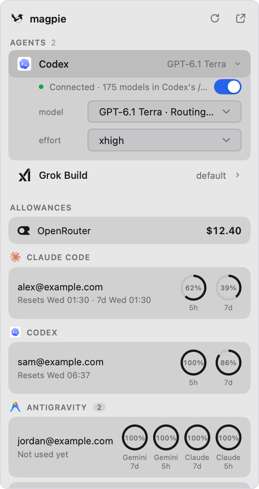

# Magpie for Metrix.Bar

[简体中文](README.zh-CN.md) · English

Control [magpie](https://github.com/yetone/magpie) from your menu bar, whether it runs on this computer or somewhere else, such as on a server. This [Metrix.Bar](https://metrix.bar/) dashboard talks to magpie's web API the same way magpie's own page does, so you can switch models and check allowances without opening a browser.

<p align="center">
  <picture>
    <source media="(prefers-color-scheme: dark)" srcset="screenshots/panel-en-dark.png">
    
  </picture>
</p>

## What it does

- **Agents**: one row per agent with its current model. Open a row to switch the model (grouped by where it comes from) and the reasoning effort, or to connect or disconnect the agent. The status line uses magpie's own wording.
- **Allowances**: grouped by provider, with a ring for each window and when it resets. Balances show beside the provider. Accounts that can't be read are folded into one line. Right-click a card to read it again.
- **Menu bar**: the first allowance's windows, such as `100% · 86%`. They read as used or left, as magpie is set to show them. If you picked allowances for magpie's own menu bar, those are shown instead.
- **Widgets**: show the selected allowances and reset times on the desktop or widget board, without account names. Click a widget to open the dashboard.
- **Language and privacy**: the panel supports English, Simplified Chinese, Traditional Chinese, Japanese, Korean, and German. It follows magpie’s language or can be set separately. The settings form follows Metrix.Bar’s display language. Account names and email addresses can follow magpie’s Hide accounts setting or be controlled separately.

## Install

You need [Metrix.Bar](https://metrix.bar/) 0.2.0 or later. Open this link to install Magpie from [this repository's registry](../README.md#install) and receive its updates:

```text
metrixbar://install/magpie?registry_url=https%3A%2F%2Fraw.githubusercontent.com%2Fthedavidweng%2Fmetrix-bar%2Fmain%2Findex.json
```

Or import the file directly. A direct import does not receive updates.

```text
metrixbar://install?url=https%3A%2F%2Fraw.githubusercontent.com%2Fthedavidweng%2Fmetrix-bar%2Fmain%2Fmagpie%2Fmagpie.bar&sha256=1dc7863e7aa9091ad23f2ffc218b0bc449ac833092b11d47c986d1ea99ab9aac
```

## Set up

### magpie on this computer

This is the default. In the magpie app, set Settings › Network and sharing › Browser access to **This computer**. That serves magpie's page on `127.0.0.1:3430`; the gateway on 3425 doesn't carry the API this dashboard needs.

The dashboard reads the page's port and key from `~/.config/magpie/web-page.json`, so there is nothing to copy, and a new key made in magpie is picked up on the next refresh. If you changed the page's port in magpie, put the same port into **Local Port**.

### magpie elsewhere

1. Set **Connect To** to magpie elsewhere.
2. Open magpie's web page from the link it prints (magpie web, or Browser access in the app). It looks like `http://HOST:PORT/?k=KEY`.
3. Put `http://HOST:PORT` into **Magpie URL** and `KEY` into **Web Key**.

## Settings

| Setting            | Default          | What it does                                                                     |
| ------------------ | ---------------- | -------------------------------------------------------------------------------- |
| Connect To         | This computer    | magpie on this computer, or elsewhere by Magpie URL                              |
| Local Port         | 3430             | This computer only: the port of magpie's Browser access                          |
| Magpie URL         |                  | Elsewhere only: scheme, host and port, without the path or `?k=`                 |
| Web Key            |                  | Elsewhere only: the value after `?k=`. Stored in the system keychain.            |
| Language           | Same as magpie   | English, Simplified Chinese, Traditional Chinese, Japanese, Korean, or German      |
| Hide Accounts      | Same as magpie   | Follows magpie's Privacy setting, or always on or off                            |
| Show Agents        | On               | The Agents section                                                               |
| Show Allowances    | On               | The Allowances section                                                           |
| Show Today's Usage | Off              | Today's requests, tokens and cost                                                |
| Menu Bar Shows     | Allowance        | The allowance text, or the icon only                                             |

## System widgets

Add Metrix.Bar from your system’s widget picker, then select Magpie. Widgets show the same allowances chosen for magpie’s menu bar, or the first available allowance if none are selected. The system decides when to refresh them, so the displayed values can lag behind the panel. Widgets do not show account names; cached values can remain visible after the app closes.

Widgets require macOS 14 or later, Windows 11 22H2 or later, or KDE Plasma 6 with the Metrix.Bar companion plasmoid.

## Privacy and permissions

- The dashboard connects only to `http://127.0.0.1:<Local Port>` and the Magpie URL you enter. Plain HTTP is allowed for the Magpie URL because magpie web usually runs on a home network or tailnet without HTTPS.
- On this computer, it reads one file, `~/.config/magpie/web-page.json`, for the page's port and key. It reads nothing else of magpie's.
- The web key grants full control of that magpie. Keep it private; Metrix.Bar keeps it in the system keychain, not in the dashboard file.
- Accounts shown with Hide accounts on stay blurred until you click the eye beside one, and are hidden again when the panel closes.

The screenshots use made-up accounts.

## License

[AGPL-3.0-only](../LICENSE)
