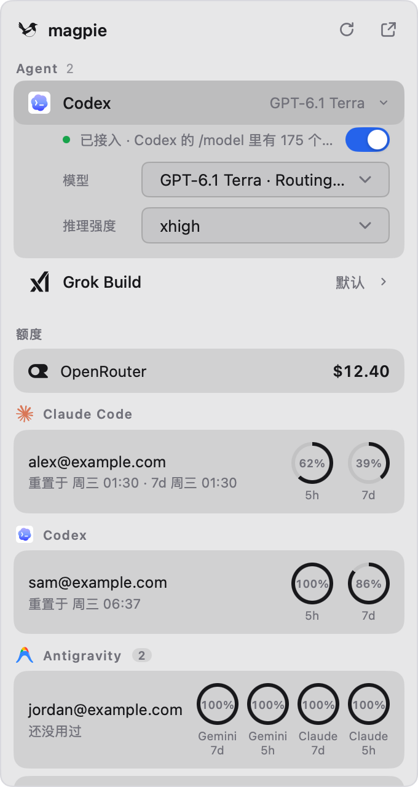

# Magpie for Metrix.Bar

简体中文 · [English](README.md)

在菜单栏里控制 [magpie](https://github.com/yetone/magpie)，本机上的和部署在别处（比如服务器上）的都行。这个 [Metrix.Bar](https://metrix.bar/) 看板和 magpie 自己的网页一样调用它的 Web API，不用打开浏览器就能切换模型、查看额度。

<p align="center">
  <picture>
    <source media="(prefers-color-scheme: dark)" srcset="screenshots/panel-zh-dark.png">
    
  </picture>
</p>

## 功能

- **Agent**：每个 Agent 一行，显示当前模型。展开后可以切换模型（按来源分组）和推理强度，也可以接入或断开。状态文字沿用 magpie 自己的说法。
- **额度**：按供应商分组，每个窗口一个圆环，并显示重置时间；余额直接显示在供应商旁边。读不到的账号收进一行，右键卡片可以重新读取。
- **菜单栏**：显示第一项额度的各窗口，比如 `100% · 86%`，是已用还是剩余跟随 magpie 的设置。如果在 magpie 里给它自己的菜单栏选了额度，就显示那几项。
- **小组件**：在桌面或小组件面板显示选中的额度和重置时间，不显示账号名。点击小组件打开看板。
- **语言与隐私**：面板支持英语、简体中文、繁体中文、日语、韩语和德语，可跟随 magpie 或单独选择；设置界面跟随 Metrix.Bar 的显示语言。账号打码可跟随 magpie 的设置，也可以单独控制。

## 安装

需要先安装 [Metrix.Bar](https://metrix.bar/) 0.2.0 或更高版本。打开这个链接，从[本仓库的看板源](../README.zh-CN.md#安装)安装 Magpie，之后可以收到更新：

```text
metrixbar://install/magpie?registry_url=https%3A%2F%2Fraw.githubusercontent.com%2Fthedavidweng%2Fmetrix-bar%2Fmain%2Findex.json
```

也可以直接导入文件，但直接导入的看板收不到更新。

```text
metrixbar://install?url=https%3A%2F%2Fraw.githubusercontent.com%2Fthedavidweng%2Fmetrix-bar%2Fmain%2Fmagpie%2Fmagpie.bar&sha256=1dc7863e7aa9091ad23f2ffc218b0bc449ac833092b11d47c986d1ea99ab9aac
```

## 配置

### 本机上的 magpie

这是默认方式。在 magpie App 里把 设置 › 网络与共享 › 浏览器访问 设为 **本机**，magpie 会在 `127.0.0.1:3430` 上提供网页。3425 是网关端口，没有看板要用的接口。

看板从 `~/.config/magpie/web-page.json` 读取网页的端口和 key，不用手动复制；在 magpie 里换了 key，下次刷新就会跟上。如果在 magpie 里改过网页端口，把 **本机端口** 改成同一个端口。

### 别处的 magpie

1. 把 **连接到** 设为通过地址连接其他设备上的 magpie。
2. 用 magpie 打印的链接打开它的网页（magpie web，或 App 里的浏览器访问），链接形如 `http://HOST:PORT/?k=KEY`。
3. 把 `http://HOST:PORT` 填进 **Magpie 地址**，把 `KEY` 填进 **网页密钥**。

## 设置项

| 设置               | 默认        | 作用                                                          |
| ------------------ | ----------- | ------------------------------------------------------------- |
| 连接到             | 本机        | 连本机的 magpie，或按 Magpie URL 连别处的                     |
| 本机端口           | 3430        | 仅本机：magpie 浏览器访问的端口                               |
| Magpie 地址        |             | 仅别处：magpie 的网页地址，协议、主机和端口，不带路径和 `?k=` |
| 网页密钥           |             | 仅别处：`?k=` 后面的值，存在系统钥匙串里                      |
| 语言               | 跟随 magpie | 英语、简体中文、繁体中文、日语、韩语或德语                    |
| 隐藏账号           | 跟随 magpie | 跟随 magpie 的隐私设置，或始终开启、始终关闭                  |
| 显示 Agent         | 开          | Agent 区块                                                    |
| 显示额度           | 开          | 额度区块                                                      |
| 显示今日用量       | 关          | 今天的请求数、Token 和费用                                    |
| 菜单栏显示         | 额度        | 显示额度文字，或只显示图标                                    |

## 系统小组件

在系统的小组件选择器中添加 Metrix.Bar，再选择 Magpie。小组件显示 magpie 菜单栏选中的额度；如果没有选择，则显示第一项可用额度。刷新时机由系统决定，显示的数据可能落后于面板。小组件不显示账号名，应用关闭后缓存的数值仍可能可见。

小组件需要 macOS 14 或更高版本、Windows 11 22H2 或更高版本，或安装了 Metrix.Bar 配套插件的 KDE Plasma 6。

## 隐私与权限

- 看板只连接 `http://127.0.0.1:<Local Port>` 和你填写的 Magpie URL。Magpie URL 允许明文 HTTP，因为 magpie web 通常跑在家庭网络或 tailnet 里，没有 HTTPS。
- 连本机时，它只读 `~/.config/magpie/web-page.json` 这一个文件来获取端口和 key，不读 magpie 的其他文件。
- Web Key 能完全控制那台 magpie，请妥善保管。Metrix.Bar 把它存在系统钥匙串里，不会写进看板文件。
- 开启账号打码时，账号会一直模糊，点旁边的眼睛才显示那一个；关闭面板后又会重新打码。

截图里的账号都是虚构的。

## 许可证

[AGPL-3.0-only](../LICENSE)
