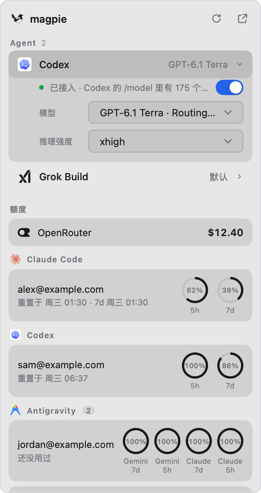

# Magpie for Metrix.Bar

简体中文 · [English](README.md)

在菜单栏里控制部署在别处（比如服务器上）的 [magpie](https://github.com/yetone/magpie)。这个 [Metrix.Bar](https://metrix.bar/) 看板和 magpie 自己的网页一样调用它的 Web API，不用打开浏览器就能切换模型、查看额度。

<p align="center">
  <picture>
    <source media="(prefers-color-scheme: dark)" srcset="screenshots/panel-zh-dark.png">
    
  </picture>
</p>

## 功能

- **Agent**：每个 Agent 一行，显示当前模型。展开后可以切换模型（按来源分组）和推理强度，也可以接入或断开。状态文字沿用 magpie 自己的说法。
- **额度**：按供应商分组，每个窗口一个圆环，并显示重置时间；余额直接显示在供应商旁边。读不到的账号收进一行，右键卡片可以重新读取。
- **菜单栏**：显示第一项额度的各窗口，比如 `100% · 86%`，是已用还是剩余跟随 magpie 的设置。如果在 magpie 里给它自己的菜单栏选了额度，就显示那几项。
- **语言与隐私**：界面语言（English 或简体中文）和账号打码跟随 magpie 的设置，打码会模糊邮箱和账号名。两者也可以在看板设置里单独修改。

## 安装

需要先装 [Metrix.Bar](https://metrix.bar/)。打开这个链接，从[本仓库的看板源](../README.zh-CN.md#安装)安装 Magpie，之后可以收到更新：

```text
metrixbar://install/magpie?registry_url=https%3A%2F%2Fraw.githubusercontent.com%2Fthedavidweng%2Fmetrix-bar%2Fmain%2Findex.json
```

也可以直接导入文件，但直接导入的看板收不到更新。

```text
metrixbar://install?url=https%3A%2F%2Fraw.githubusercontent.com%2Fthedavidweng%2Fmetrix-bar%2Fmain%2Fmagpie%2Fmagpie.bar&sha256=54696bec130e46afdade9f7bcecb6ba3d1a61dbc6c014890c1aadf356c0bbf82
```

## 配置

1. 用 magpie 打印的链接打开它的网页（magpie web，或 App 里的 设置 › 网络与共享 › 浏览器访问），链接形如 `http://HOST:PORT/?k=KEY`。
2. 在看板设置里，把 `http://HOST:PORT` 填进 **Magpie URL**，把 `KEY` 填进 **Web Key**。

## 设置项

| 设置               | 默认        | 作用                                                  |
| ------------------ | ----------- | ----------------------------------------------------- |
| Magpie URL         |             | magpie 的网页地址：协议、主机和端口，不带路径和 `?k=` |
| Web Key            |             | `?k=` 后面的值，存在系统钥匙串里                      |
| Language           | 跟随 magpie | English 或简体中文                                    |
| Hide Accounts      | 跟随 magpie | 跟随 magpie 的隐私设置，或始终开启、始终关闭          |
| Show Agents        | 开          | Agent 区块                                            |
| Show Allowances    | 开          | 额度区块                                              |
| Show Today's Usage | 关          | 今天的请求数、Token 和费用                            |
| Menu Bar Shows     | 额度        | 显示额度文字，或只显示图标                            |

## 隐私与权限

- 看板只连接你填写的 Magpie URL。这个地址允许明文 HTTP，因为 magpie web 通常跑在家庭网络或 tailnet 里，没有 HTTPS。
- Web Key 能完全控制那台 magpie，请妥善保管。Metrix.Bar 把它存在系统钥匙串里，不会写进看板文件。
- 开启账号打码时，账号会一直模糊，点旁边的眼睛才显示那一个；关闭面板后又会重新打码。

截图里的账号都是虚构的。

## 许可证

[AGPL-3.0-only](../LICENSE)
